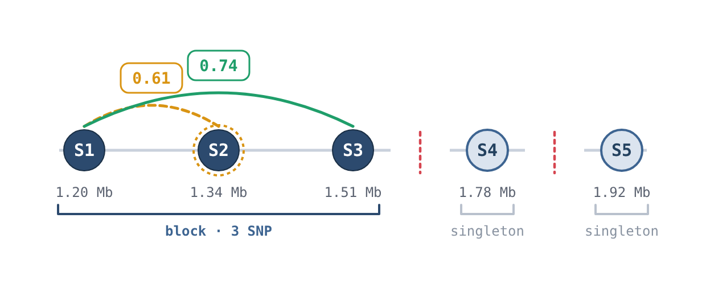
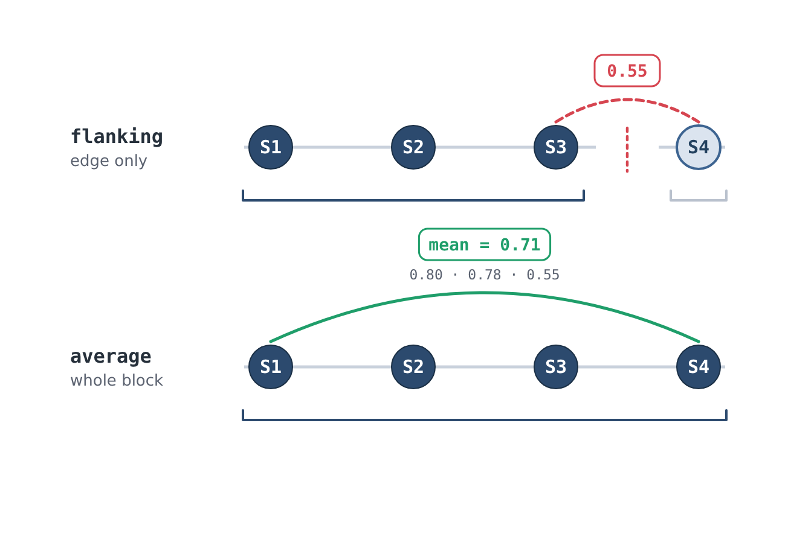
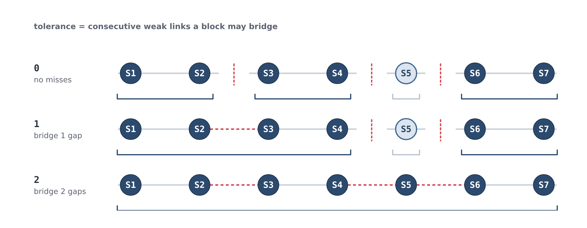
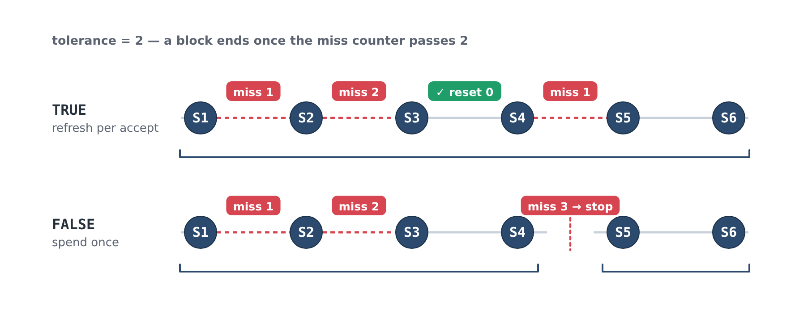
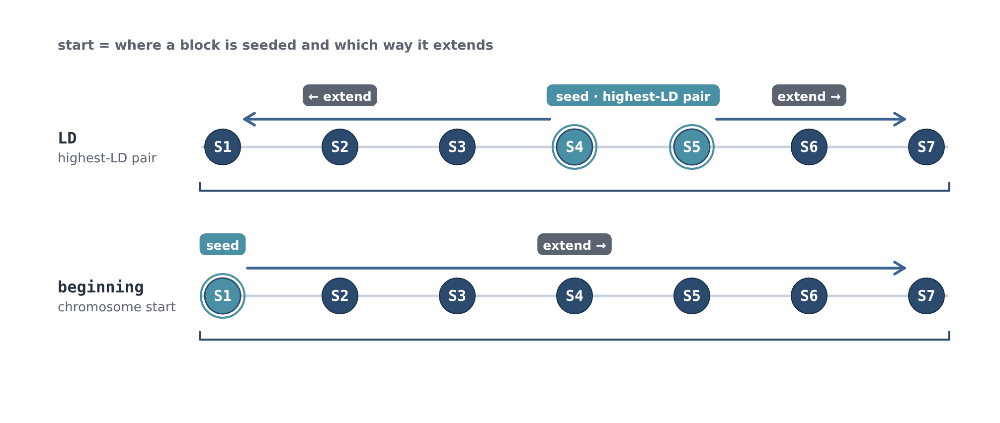
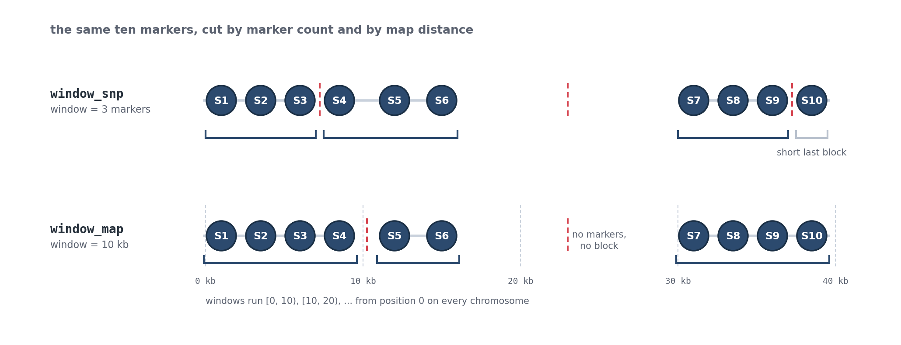
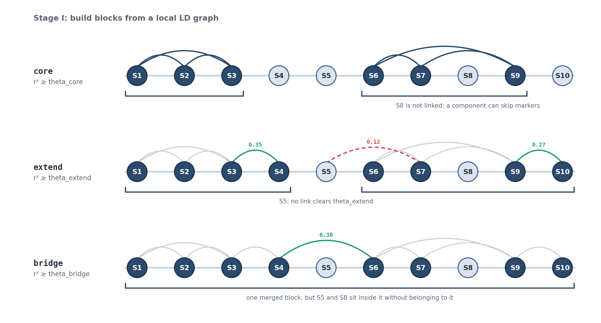
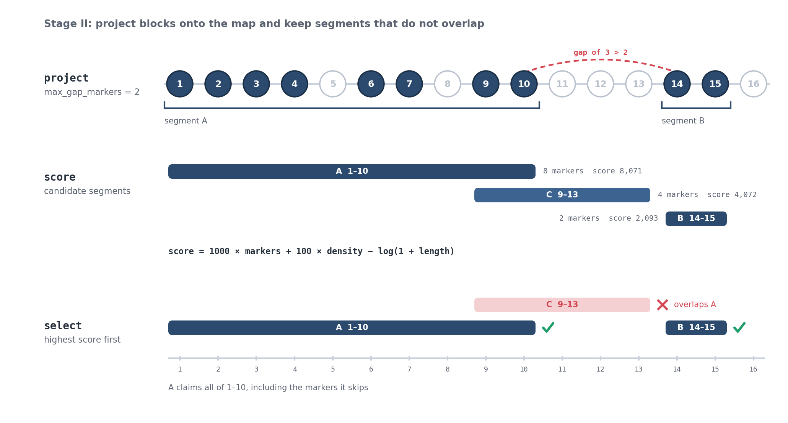
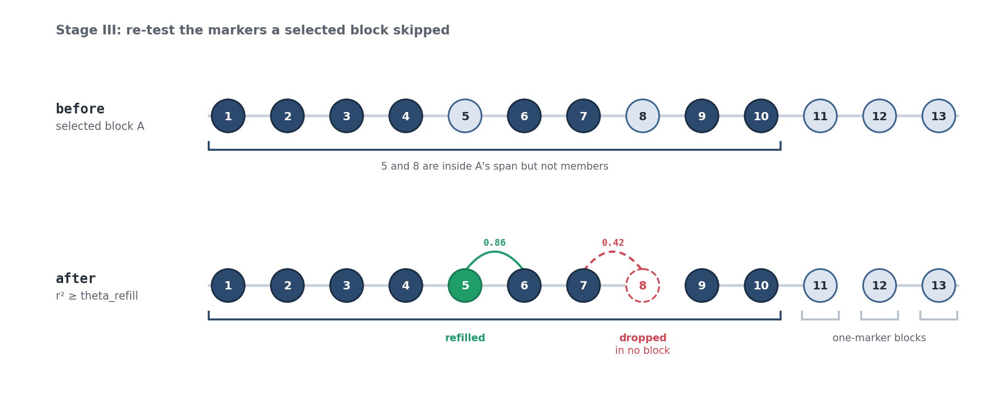

# Haplotype Blocks

Haplotype blocks (haploblocks) are contiguous genomic regions that are treated as a single unit for localGEBV, haplotype effects, and parent selection. HapSelect offers three ways to define them:

| Strategy | Groups markers by | Needs | Best suited to |
|:---|:---|:---|:---|
| `ld_strategy()` | Linear extension from the highest LD pairs | Pairwise LD table | The classic localGEBV haploblocking approach |
| `window_strategy()` | A fixed number of markers or a fixed map distance | Map only | Quick, LD-free blocking or a baseline comparison |
| `graph_strategy()` | Connected groups of markers in a local LD graph | Genotype matrix | Larger, more complete blocks with fewer singletons |

## `def_blocks()`

All three strategies run through `def_blocks()`. A strategy holds *how* to block, while `def_blocks()` is given *what* to block.

```r
haploblocks <- def_blocks(
  map      = map,                       #ordered map from order_map()
  strategy = ld_strategy(ld = ld_pairs), #ld_strategy(), window_strategy(), or graph_strategy()
  geno     = NULL                       #genotype matrix - required by graph_strategy() only
)

#turn the list object into a data frame for downstream steps
haploblocks <- block_obj_to_df(haploblocks, map = map)
```

| Parameter | Description |
|:---|:---|
| `strategy` | A strategy object built by `ld_strategy()`, `window_strategy()`, or `graph_strategy()` |
| `map` | Ordered marker map from `order_map()` |
| `geno` | Dosage genotype matrix. Required by `graph_strategy()`, which computes LD directly from it, and ignored (with a warning) by the other strategies |

!!! warning
    `def_blocks()` changed in v2.0.0. The LD parameters (`ld`, `method`, `threshold`, etc.) are no longer passed to `def_blocks()` directly - they now go into `ld_strategy()`. Code written for v1 will need to be updated!

---

## `ld_strategy()`

Grows blocks outward from seed marker pairs one marker at a time while LD stays high, using a pre-computed pairwise LD table (see [Pairwise LD](pairwise-ld.md)).

```r
haploblocks <- def_blocks(
  map         = map,
  strategy    = ld_strategy(
    ld        = ld_pairs,
    method    = "flanking",
    threshold = 0.7,
    tolerance = 1,
    tol_reset = TRUE,
    start     = "LD",
    parallel  = FALSE
  )
)
```

| Parameter | Default | Description |
|:---|:---|:---|
| `ld` | | Pairwise LD output from `pairwise_ld()`, `plink_pairwise_ld()`, or `plink_pairwise_ld_geno()` |
| `method` | `"flanking"` | Block definition method (`"flanking"` or `"average"`) |
| `threshold` | `0.7` | Minimum r² value to consider adding a marker to the block (between 0 and 1) |
| `tolerance` | `1` | Number of markers allowed to fall below `threshold` before terminating a block |
| `tol_reset` | `TRUE` | If `TRUE`, reset the tolerance counter when a marker is successfully added to a block |
| `start` | `"LD"` | Seed strategy for block boundaries (`"LD"` or `"beginning"`) |
| `parallel` | `FALSE` | Process chromosomes in parallel, using up to the number of cores allowed by `set_cpu_cores()` (see [Configuration](../configuration.md)) |

**`method`**

- `"flanking"` → compares the LD of the adjacent marker only (i.e., compares current first/last marker in the block to the next marker)
- `"average"` → compares average LD across block (i.e., averages the next marker's LD to all markers currently in the block)

**`tolerance`**

- If the next marker to compare does not meet or exceed `threshold`, the counter is incremented by 1. Once the counter is greater than the `tolerance` value the block is terminated. Any markers between a successfully added marker and the block that did not meet the threshold will also be added to the block. This parameter helps to accommodate for reference alignment error, genotyping error, structural variation, and other systematic errors

**`tol_reset`**

- `TRUE` the `tolerance` counter is reset to 0 when a marker meets the threshold.
- `FALSE` the counter is not reset and will keep incrementing even if a marker is successfully added.

**`start`**

- `"LD"` -> starts from the highest LD pair and the block will be extended both to the left and to the right according to the distance coordinate. The tolerance counter is reset between left extension and right extension.
- `"beginning"` -> starts at the beginning of the chromosome, so blocks are only extended to the right.

!!! tip
    `threshold` must be between 0 and 1 and `tolerance` must be a non-negative number, otherwise `ld_strategy()` will stop with an error before any blocking is attempted.

### How LD blocks are built

`ld_strategy()` walks along a chromosome and extends a block one marker at a time,
absorbing markers while LD stays high and closing the block off to start a new
one where it drops away. The diagrams below illustrate how the parameters above
shape that process.

In each diagram, circles are markers laid out in physical order along the
chromosome. A grey line is a strong link (LD ≥ `threshold`) and a dashed red line
is a weak link (LD below `threshold`). A bracket underneath groups the markers
that end up in one block, and an upright dashed red line marks a block boundary.

> LD values in these diagrams are illustrative, chosen to make each behaviour
> visible.

<video class="method-video" src="../../assets/ld-blocking-matrix.mp4" poster="../../assets/ld-blocking-matrix-poster.jpg" autoplay loop muted playsinline></video>
<p class="method-video-caption">LD blocking on 150 markers of the bundled example data (<code>threshold = 0.7</code>, <code>start = "LD"</code>). The triangle is the pairwise LD between markers; blocks form along the bottom from the highest LD pair down, not from left to right.</p>

#### Growing a block

A block grows outward from a seed. Each new marker (the *candidate*) is compared
against the block; if the LD clears `threshold` the candidate joins. A marker
that falls short isn't dropped straight away. It can be **tolerated** and
absorbed if a later marker reaches back across it. Where LD stays too low, the
block is closed off and the next block begins.



Here `S2` is a weak link (`0.61`), but the block reaches across it to `S3`
(`0.74 ≥ 0.70`), so `S2` is pulled in. Extension later runs out of road, so the
block ends and `S4` and `S5` are left as their own single-marker blocks.

#### `method`: what a candidate is compared against

`flanking` compares the candidate to the block **edge** only; `average` compares
it to the **mean** LD across the whole block. Same markers, opposite result:
under `flanking` the weak `LD(S3, S4) = 0.55` ends the block, while under
`average` the strong ties to `S1` and `S2` lift the mean to `0.71` and `S4`
joins.



#### `tolerance`: how many weak links a block bridges

`tolerance` is the number of consecutive weak links the block may span before it
gives up. On the same LD landscape, raising it bridges wider gaps, producing
fewer, longer blocks and fewer singletons.



#### `tol_reset`: whether an accepted marker forgives past misses

Each weak link the block spans adds to a miss counter, and the block is closed
off once that counter passes `tolerance`. `tol_reset` decides whether accepting a
marker resets the counter. With `tolerance = 2` in both rows below: under `TRUE`,
absorbing `S4` resets the counter, so the later weak link is affordable and the
block runs to the end; under `FALSE`, the two early misses have already spent the
budget, so the next weak link closes the block.



#### `start`: where a block is seeded and which way it grows

`start` sets the seed and the growth direction. `"LD"` seeds from the highest-LD
adjacent pair and extends in **both** directions, resetting the tolerance counter
between the left and right passes. `"beginning"` seeds at the first marker on the
chromosome and extends **rightward** only.



---

## `window_strategy()`

Cuts blocks straight from the map with no reference to LD. Blocks are either a fixed number of markers or a fixed map distance. No LD table or genotype matrix is needed.

```r
#fixed number of markers per block
haploblocks <- def_blocks(
  map         = map,
  strategy    = window_strategy(
    window    = 50,             #every 50 SNP
    method    = "window_snp"
  )
)

#fixed map distance per block
haploblocks <- def_blocks(
  map         = map,
  strategy    = window_strategy(
    window    = 1e6,            #1 Mb windows for a physical map (use cM for a genetic map)
    method    = "window_map"
  )
)
```

| Parameter | Default | Description |
|:---|:---|:---|
| `window` | | Block size. A whole number of markers for `"window_snp"`, or a distance in the map's own `Position` units (bp or cM) for `"window_map"` |
| `method` | `"window_snp"` | `"window_snp"` (fixed number of markers) or `"window_map"` (fixed map distance) |

**`method`**

- `"window_snp"` → consecutive runs of `window` markers. The last block on a chromosome is short when the number of markers is not evenly divisible by `window`.
- `"window_map"` → intervals of `[0, window)`, `[window, 2 × window)`, ... starting from position 0 on every chromosome. An interval with no markers produces no block, so the number of blocks follows marker density rather than chromosome length.



!!! warning
    `window` is in the units of your map! For a physical map `window = 1e6` is 1 Mb, but for a genetic map in cM it would be one block per chromosome. Fractional windows are allowed for `"window_map"`, but `"window_snp"` requires a whole number.

!!! tip
    Markers with a missing `Chromosome` or `Position` are dropped with a warning, and an unsorted map is sorted with a warning. Run `order_map()` first to avoid both.

---

## `graph_strategy()`

Graph-based blocking is a new implementation and is similar in concept to LD-based blocking. Rather than growing a block one marker at a time from a single chain of pairwise comparisons, it builds a sparse **local LD graph** over each chromosome and reads blocks off its structure, so a block is defined by how its markers hang together as a group. Because LD is only computed within a short window of each marker, it does not require genome-wide pairwise LD and LD is calculated internally from `geno`.

The method was developed by Jingyang Tong (QAAFI, The University of Queensland).

```r
haploblocks <- def_blocks(
  map          = map,
  geno         = geno,              #required! LD is computed directly from the genotypes
  strategy     = graph_strategy(
    theta_core        = 0.80,
    theta_core_by_chr = NULL,
    theta_extend      = 0.20,
    theta_bridge      = 0.20,
    theta_refill      = 0.80,
    ld_min_r2         = 0.20,
    window_ld         = 20,
    window_core       = 20,
    window_extend     = 50,
    min_links         = 1,
    max_gap_snps      = 2,
    max_gap_markers   = 2,
    max_gap_position  = NULL,
    min_block_snps    = 2,
    parallel          = FALSE
  )
)
```

!!! warning
    `graph_strategy()` **MUST** be given `geno` in `def_blocks()`, otherwise it will stop with an error. `geno` is aligned to `map` by marker name (see `order_geno()` in [Pairwise LD](pairwise-ld.md)), so markers missing from either file are dropped with a warning.

<video class="method-video" src="../../assets/graph-blocking.mp4" poster="../../assets/graph-blocking-poster.jpg" autoplay loop muted playsinline></video>
<p class="method-video-caption">Graph blocking on one chromosome of the bundled example data with the default parameters: core edges, extension and bridge edges, the resulting components, linearisation (Stage II) and refill (Stage III). Each point is a marker, laid out by its LD connections rather than its map position.</p>

### Parameters

| Parameter | Default | Stage | Description |
|:---|:---|:---|:---|
| `theta_core` | `0.80` | I | Minimum r² for a core edge between two markers |
| `theta_core_by_chr` | `NULL` | I | Named vector of per-chromosome `theta_core` overrides, e.g., `c("1" = 0.9, "2" = 0.8)` |
| `theta_extend` | `0.20` | I | Minimum r² for attaching an ungrouped marker to a block |
| `theta_bridge` | `0.20` | I | Minimum r² for a boundary edge that merges two adjacent blocks |
| `theta_refill` | `0.80` | III | Minimum r² for refilling a marker left inside a block's span |
| `ld_min_r2` | `0.20` | I | LD floor - edges below this are never stored |
| `window_ld` | `20` | I | Number of markers ahead of each marker to compute LD with |
| `window_core` | `20` | I | Maximum marker distance for a core edge |
| `window_extend` | `50` | I | Maximum marker distance to the nearest member of a block being extended |
| `min_links` | `1` | I | Minimum number of supporting edges for an extension |
| `max_gap_snps` | `2` | I | Maximum number of markers between two blocks that a bridge may cross |
| `max_gap_markers` | `2` | II | Maximum gap between consecutive members (in marker positions) before a block is split |
| `max_gap_position` | `NULL` | II | Maximum gap between consecutive members in map units before a block is split, or `NULL` for no limit |
| `min_block_snps` | `2` | II | Minimum number of markers for a segment to be kept |
| `parallel` | `FALSE` | | Process chromosomes in parallel, using up to the number of cores allowed by `set_cpu_cores()` (see [Configuration](../configuration.md)) |

All r² thresholds (`theta_*` and `ld_min_r2`) must be between 0 and 1, and all window, gap, and count parameters must be whole numbers. `graph_strategy()` will also stop with an error if `ld_min_r2` is above `theta_core`, `theta_extend`, `theta_bridge`, or any `theta_core_by_chr` value, because edges below `ld_min_r2` are never stored and those thresholds could never be applied. A `window_core` larger than `window_ld` produces a warning, since pairs beyond `window_ld` are never computed.

### How graph blocks are built

The method runs in three stages on each chromosome. In the diagrams below, circles are markers in physical order, arcs above the track are LD edges, and a bracket underneath groups the markers in one block. Light circles are markers that do not (yet) belong to a block.

> LD values in these diagrams are illustrative, chosen to make each behaviour
> visible.

#### Stage I: build blocks from a local LD graph



1. **Core components** - LD is computed between each marker and the next `window_ld` markers. Every pair with r² ≥ `theta_core` (and within `window_core` markers) becomes an edge, and each connected group of two or more markers becomes a core block. A core block does not have to be a contiguous run of markers: `S6`, `S7`, and `S9` are connected without `S8`.
2. **Extension** - each ungrouped marker joins a neighbouring block if it has at least `min_links` edges with r² ≥ `theta_extend` to that block and the nearest member of the block is within `window_extend` markers. If more than one block qualifies, the block with the most supporting edges is chosen, then the highest mean r², then the nearest. Markers are attached one at a time, so a marker that has just joined a block can pull in the next one.
3. **Bridging** - adjacent blocks separated by no more than `max_gap_snps` markers are merged when any of the last three markers of one block has an edge with r² ≥ `theta_bridge` to any of the first three markers of the next. Bridging merges the two blocks, but it does **not** absorb the markers in the gap between them (`S5` above).

Any marker still ungrouped at the end of Stage I becomes a one-marker block.

**`theta_core_by_chr`**

Some genomes have very different LD between chromosomes (e.g., the A, B, and D subgenomes of bread wheat), so a single `theta_core` may be too strict for some chromosomes and too lenient for others. `theta_core_by_chr` replaces `theta_core` for the chromosomes it names. Names must match the chromosome numbers in the map after `order_map()`, otherwise `def_blocks()` will stop with an error.

```r
#a lower core threshold on chromosomes 1 and 2, theta_core everywhere else
strategy = graph_strategy(theta_core = 0.8, theta_core_by_chr = c("1" = 0.7, "2" = 0.7))
```

#### Stage II: project blocks onto the map and keep segments that do not overlap



A block from Stage I is a set of connected markers, which can skip markers or jump across the chromosome. A haploblock must be a contiguous region, so each block is projected back onto the map:

1. **Split** - members are put in map order, and the block is split wherever consecutive members are more than `max_gap_markers` positions apart (or more than `max_gap_position` apart in map units, if given). Segments with fewer than `min_block_snps` markers are discarded.
2. **Score** - each candidate segment is scored as:

$$
\text{score} = 1000 \times n_{\text{markers}} + 100 \times \frac{n_{\text{markers}}}{\text{span}} - \log(1 + \text{length})
$$

where \(n_{\text{markers}}\) is the number of markers in the segment, span is the number of marker positions from its first to its last marker, and length is its map distance. The number of markers dominates, density breaks ties, and a shorter segment is preferred when both are equal.

3. **Select** - segments are taken from the highest score down, and a segment is kept only if its whole interval is still free. A kept segment claims its entire interval, including any markers it skips, so this is a greedy selection rather than a search for the best overall set.

#### Stage III: re-test the markers a selected block skipped



After selection, some markers sit inside a block's span without belonging to it. Each one is re-tested against the block that encloses it, and joins the block if its r² with **any** current member is ≥ `theta_refill`. LD is recomputed from the genotypes here, so `window_ld` and `ld_min_r2` do not limit the comparison. Markers outside every selected block are kept as one-marker blocks.

!!! warning
    A marker inside a block's span that fails the refill test is **dropped** and appears in **no** block. Unlike `ld_strategy()` and `window_strategy()`, the graph method does not guarantee every marker in the map is assigned to a block! On the bundled example data with the default parameters, 486 of the 6,070 markers are dropped. Dropped markers do not contribute to localGEBV or haplotype effects. Lowering `theta_refill` keeps more of them, and `attr(haploblocks, "graph_diagnostics")` reports how many were dropped on each chromosome (see below).

### Diagnostics

`def_blocks()` attaches a per-chromosome summary to its output when using `graph_strategy()`. Inspect it before converting to a data frame, as `block_obj_to_df()` does not keep it:

```r
haploblocks <- def_blocks(map = map, geno = geno, strategy = graph_strategy())

attr(haploblocks, "graph_diagnostics")
```

| Column | Description |
|:---|:---|
| `chromosome` | Chromosome number |
| `theta_core` | `theta_core` used on this chromosome, after any `theta_core_by_chr` override |
| `n_blocks` | Total number of blocks |
| `n_multi_marker_blocks` | Number of blocks with two or more markers |
| `n_single_marker_blocks` | Number of one-marker blocks |
| `n_markers_in` | Markers on the chromosome |
| `n_markers_out` | Markers placed in a block |
| `n_refilled` | Markers added back to a block in Stage III |
| `n_dropped` | Markers dropped in Stage III (in no block) |

---

## `block_obj_to_df()`

Converts the block list object from `def_blocks()` to a data frame for downstream use. This is the same for every strategy.

```r
haploblocks <- block_obj_to_df(haploblocks, map)
```

The resulting data frame has one row per haploblock:

| Column | Description |
|:---|:---|
| `Block` | Constituent markers, `;` delimited |
| `Block_ID` | Unique block identifier, `Chromosome:Block` (e.g., `"3:132"` is the 132nd block on chromosome 3) |
| `Num_SNP` | Number of markers in the block |
| `First_SNP` / `Last_SNP` | First and last marker in the block |
| `Chrom` | Chromosome |
| `Start_Pos` / `End_Pos` | Map position of `First_SNP` and `Last_SNP` |
| `Block_Size` | `End_Pos - Start_Pos` (0 for single-marker blocks) |

!!! warning
    Do not use any kind of whitespace as a delimeter, this will not be considered a delimeter and will be part of the marker name!

## `block_summary()`

Reports basic statistics across all blocks.

```r
block_summary(block_df = haploblocks)
```

| Column | Description |
|:---|:---|
| `Mean_SNP_per_Block` / `Max_SNP_per_Block` | Mean and maximum number of markers per block |
| `Mean_Block_Size` / `Max_Block_Size` | Mean and maximum `Block_Size` of multi-marker blocks |
| `Singleton_Blocks` | Number of single-marker blocks |
| `Percent_Singleton_Blocks` | Percentage of blocks that are single-marker blocks |

!!! tip
    `Mean_Block_Size` does not include singleton blocks (size 0) in the computation. It is the mean size of multi-SNP blocks. `block_summary()` is a quick way to compare strategies or parameter settings on the same data.

## Important Note
A custom haploblock dataframe may be provided for downstream steps. It must, however, be formatted the same with the same column names! At minimum, the `Block`, `Block_ID`, `First_SNP`, `Last_SNP`, and `Chrom` columns must be provided! The `Block` column should contain the list of markers in the block separated by `;` (no whitespace!), the `Block_ID` should be a character and a unique identifier, `First_SNP` and `Last_SNP` should be the character name of the first and last SNP making up the block in `Block`, and `Chrom` should be a numeric positive integer value.

```r
head(haploblocks)
```
