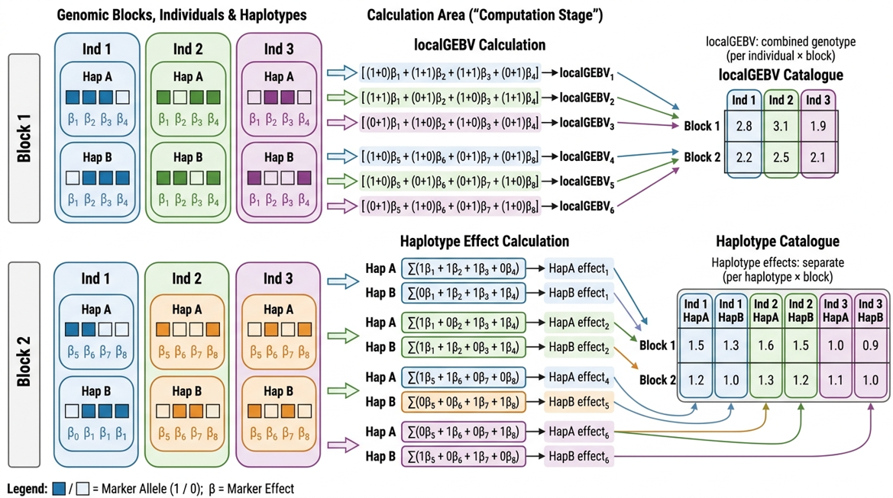

#localGEBV and Haplotype Effects

## LocalGEBV

Local genomic estimated breeding values (localGEBV) quantify the breeding value contribution of each haploblock for each individual. The localGEBV are calculated as:

$$
\text{localGEBV}_{jk} = \sum_{i \in \text{block}_j} ({x_{ik}} - \overline{x_{i}}) \cdot \hat{\alpha}_i
$$

where \(({x_{ik}} - \overline{x_{i}})\) is the **centered** (see [VanRaden, 2008](https://doi.org/10.3168/jds.2007-0980)) allele dosage of individual \(k\) at marker \(i\) in haploblock \(j\), and \(\hat{\alpha}_i\) is the estimated marker effect. If `mean_adjust = FALSE`, then it is not centered and is the actual value.

This produces an **\(\text{J × N}\) matrix** of localGEBV values — one value per individual for \(N\) individuals per haploblock for \(J\) haploblocks — which captures the breeding value contribution of each genomic region separately.

Haploblock variance is then computed as:

$$
\text{var}(\mathbf{\text{localGEBV}_j}) = \frac{\sum_k \left( \text{localGEBV}_{jk} - \overline{\text{localGEBV}_j} \right)^2}{N}
$$

## Haplotype Effects

Similarly, haplotype effects can be calculated as the per-chromosome contribution:

$$
\text{Haplotype}_{jkl} = \sum_{i \in \text{block}_j} ({x_{ikl}} - \frac{\overline{x_{i}}}{2}) \cdot \hat{\alpha}_i
$$

where all terms are the same, except \(({x_{ikl}} - \frac{\overline{x_{i}}}{2})\) is the **centered** allele of individual \(k\) on chromosome \(l\) at marker \(i\) in haploblock \(j\) and the result is the haplotype effect of individual \(k\) for chromosome \(l\) and haploblock \(j\). The centered allele is equivalent to subtracting the allele frequency, p, from the allele in 0/1 format. Dividing the mean dosage by 2 is equivalent for a diploid where the mean is 2p. If the mean is equivalent to 2p for a diplid, then the mean of a haplotype (on average 1/2 of the GEBV) if simply p, which is the mean divided by 2.

This produces an **\(\text{J × NL}\) matrix** of haplotype effects — one value per individual per chromosome for \(L\) chromosome sets per haploblock for \(J\) haploblocks.

Variance is compute in the same fashion. However, because there are LN (LN = 2N for diploid) values per haploblock and each haplotype effect is less than a corresponding localGEBV (exactly 1/2 if the case of a completely inbred and homozygous population), the variance of haplotype effects is usually substantially less the variance of localGEBV. However, the ranking of blocks is still the same for completely inbred populations and likely highly correlated even for highly outbred populations. Thus, its intended purpose as a metric to choose informative haploblocks and assess genome architecture is nearly invariant to choose of localGEBV or haplotype effects.


## Formulas Visualised



## `compute_local_GEBV()` and `compute_haplotype_effects()` functions

```r
#localGEBV
haploblock_obj <- compute_local_GEBV(
  geno           = geno,
  marker_effects = marker_effects,
  haploblocks_df = haploblocks,
  set_missing_NA = TRUE,            #if TRUE, any missing genotypes in a block will return NA for the localGEBV
  mean_adjust    = TRUE,            #centeres the genotype matrix - this should be TRUE in almost every case! Setting to FALSE will lead to biased localGEBV!
  parallel       = FALSE,           #if TRUE, process blocks in parallel
  chunk_size     = 100              #maximum number of blocks sent to a parallel worker at once
)

#haplotypes
haploblock_obj <- compute_haplotype_effects(
  geno           = geno_phased,
  marker_effects = marker_effects,
  haploblocks_df = haploblocks,
  set_missing_NA = TRUE,            #if TRUE, any missing alleles in a block will return NA for the haplotype effect
  mean_adjust    = TRUE,            #centeres the allele matrix - this should be TRUE in almost every case! Setting to FALSE will lead to biased haplotype effects!
  parallel       = FALSE,
  chunk_size     = 100
)
```

| Parameter | Default | Description |
|-----------|---------|-------------|
| `geno` | | Dosage genotype matrix (`compute_local_GEBV()`) or phased genotype matrix (`compute_haplotype_effects()`). See [Getting Started](../getting-started.md) |
| `marker_effects` | | Data frame with columns for SNP ID and estimated effect |
| `haploblocks_df` | | Haploblock data frame from `block_obj_to_df()` |
| `set_missing_NA` | `TRUE` | If `TRUE`, replaces localGEBV/haplotype effects for any individual with missing genotypes with `NA` |
| `mean_adjust` | `TRUE` | Centers the genotypes, required in most cases |
| `parallel` | `FALSE` | If `TRUE`, process haploblocks in parallel, using up to the number of cores allowed by `set_cpu_cores()` (see [Configuration](../configuration.md)) |
| `chunk_size` | `100` | Maximum number of haploblocks sent to a parallel worker at once. Only used when `parallel = TRUE` |

!!! warning
    Use the dosage genotype matrix (e.g., `HapSelect::geno`) with `compute_local_GEBV()` and the phased genotype matrix (e.g., `HapSelect::geno_phased`) with `compute_haplotype_effects()`. They are not interchangeable!

### `set_missing_NA`

-`TRUE` if a haplotype/marker configuration for an individual in a haploblock is missing $>=$ 1 genotype call, the localGEBV value/haplotype effect for that individual's block is set to `NA`.

-`FALSE` localGEBV/haplotype effects are calculated with all non-missing genotypes. The missing genotypes are imputed to the mean. In the case of `mean_adjust = TRUE`, this is 0 and thus do not affect the value. For uncentered marker matrices, this is the genotype mean ($2p$ for a diploid, or $lp$ for other ploidy where $l$ is ploidy and $p$ is the alternative allele frequency). An individual missing **every** genotype in a block is still set to `NA`.

### `mean_adjust`

-`TRUE` centers the genotypes/alleles according to [VanRaden, 2008](https://doi.org/10.3168/jds.2007-0980). This is a necessary step in the vast majority of cases to prevent biasing localGEBV/haplotype effects and GEBV. It does not affect haploblock variance, but it may affect how parents are chosen in the GA.

-`FALSE` does not center the genotypes/alleles. 

!!! warning
    If marker effects are computed using an additive genetic model like GBLUP backsolve, rrBLUP, BayesC, etc., this **WILL** lead to biased localGEBV/haplotype effects and GEBV!!! Only set this to `FALSE` if you are confident in what you are doing!

### `parallel` and `chunk_size`

With `parallel = TRUE`, haploblocks are grouped into chunks of similar computational cost and the chunks are processed across parallel workers. Results are identical to `parallel = FALSE`.

- Larger blocks (more markers or individuals) take longer, so chunks are balanced by estimated cost rather than by the number of blocks.
- `chunk_size` caps the number of blocks in a chunk, which caps the amount of genotype data sent to each worker. Lower it if R runs out of memory in parallel mode.

!!! tip
    Starting parallel workers takes a few seconds, so the benefit of `parallel = TRUE` grows with the number of blocks and individuals. On very small datasets it may not be faster than `parallel = FALSE`.

## Output Object

`compute_local_GEBV()` and `compute_haplotype_effects()` return a list with:

- **`$Haploblocks`** — haploblock dataframe from [Haplotype Blocks](haploblocks.md) extended with:
    - `Num_Uniq_Hap` — number of unique haplotypes (marker or allele configurations for localGEBV and haplotype effects, respectively) observed in the block
    - `Block_Var` — population variance of localGEBV/haplotype effects across individuals (or chromosomes). This is the variance used to rank blocks
    - `Unique_Haplo_Block_Var` — population variance of the effects of the **unique** haplotypes, ignoring how often each occurs
- **`$Haplotype_ID_Matrix`** - blocks (J) × individuals (K) or chromosomes (KL) matrix of unique localGEBV/haplotype IDs listed in `$Haplotypes` dataframe
- **`$Haplotype_Effect_Matrix`** — blocks (J) × individuals (K) or chromosomes (KL) of haplotype effects/localGEBV values corresponding to `$Haplotype_ID_Matrix` IDs and `$Haplotypes` dataframe IDs and values.
- **`$Haplotypes`** - dataframe containing the unique haplotype/genotype configurations in each haploblock as well as their localGEBV estimates, with columns:
    - `Block_ID` — the haploblock
    - `Haplo_ID` — unique ID of the haplotype, `Block_ID:number` (e.g., `"1:2:3"` is the 3rd unique haplotype in block `1:2`)
    - `Haplotype` — the genotypes/alleles at each marker in the block, comma separated in marker order (e.g., `"0,2,1"`)
    - `Haplotype_Effect` — localGEBV/haplotype effect of that configuration

## Marker Effects Input

The `marker_effects` data frame must have:

- Column 1: SNP ID matching the map file
- Column 2: Estimated marker effect (e.g., from `rrBLUP::mixed.solve()`)

See [Marker Effects](marker-effects.md) for more information.

```r
head(HapSelect::marker_effects)
```
